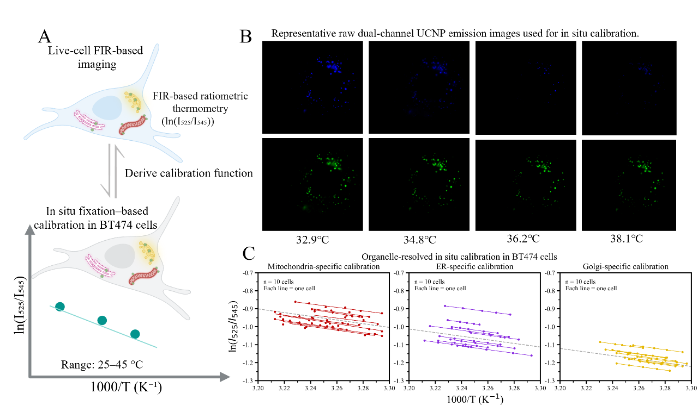
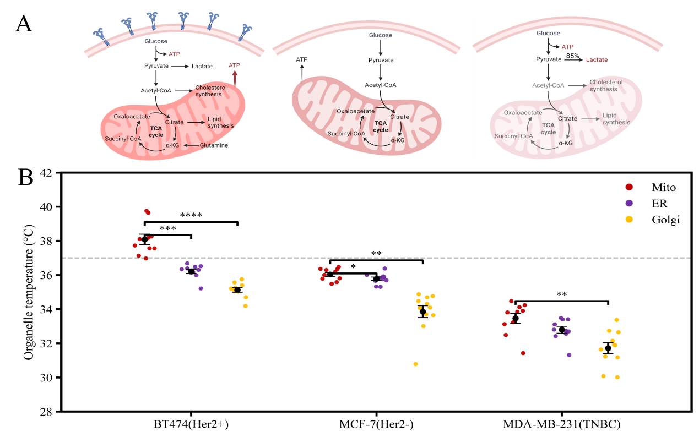

# Organelle Thermal Signatures

**Experimental molecular imaging × ratiometric thermometry × quantitative microscopy**

This repository documents exploratory image-analysis scripts and selected experimental figures from the author-provided manuscript:

*Membrane-camouflaged upconversion nanothermometers uncover organelle-specific thermal signatures of cancer metabolism.*

> **Status:** Research manuscript figures and computational analysis code. Publication status has not been verified. This repository does not claim that the refactored computational methods independently reproduced the manuscript's reported temperatures.

## Results at a glance

| Thermometric calibration | Breast-cancer organelle comparison |
|---|---|
|  |  |

The manuscript uses the Er³⁺ emission pair near **525 and 545 nm**, fixed-cell **in situ calibration**, and mitochondria/ER/Golgi-specific measurements in breast-cancer cells. Measurements are interpreted within the scope and limitations described in the manuscript.

**[Browse the complete experimental figure gallery →](results/README.md)**

## Spin-TIRF microscopy system


The original experimental setup combines **488, 561, 642 and 980 nm laser excitation**, galvanometer-driven **spinning TIRF** illumination through a **100×/1.45 NA objective**, and **525/545 nm emission-band imaging** using an **sCMOS camera**. The two-channel UCNP emission ratio supports calibration-dependent subcellular thermometry. The schematic documents the optical system; it does not independently validate temperatures or make the legacy analysis scripts into acquisition-control software.

**[Optical layout, acquisition principles and documented settings →](docs/spin_tirf_system_setup.md)**

## Experimental-to-computational workflow

```text
UCNP synthesis and membrane camouflage
                  ↓
Organelle-selective targeting + microscopy
                  ↓
525 nm / 545 nm emission acquisition
                  ↓
Image registration + segmentation / ROI QC
                  ↓
ln(I525/I545) per validated organelle region
                  ↓
In situ temperature calibration (cell/organelle specific)
                  ↓
Temperature inference + QC
                  ↓
Cell-level summaries / statistical comparisons
```

The diagram summarizes an intended analysis process. Actual manuscript measurements are **not automatically reproduced by executing the public repository scripts**.

## Source code (legacy exploratory scripts)

- `Fluorescence Ratio Temperature Calibration Curve.py` — thermometric calibration analysis.
- `Mito ER Golgi Tri-channel merge temperature.py` — multichannel registration, ROI selection, and temperature-map generation.
- `Mito ER Golgi l temperature.py` — analysis and display of organelle temperature comparisons.

These scripts reflect historical analysis iterations. They require local input data and contain hard-coded paths. Some selection steps were tuned toward warmer estimates; they **must not** be interpreted as an independently validated, bias-free thermometry pipeline. For rigorous reanalysis, fix acquisition/processing rules prior to analysis and report sensitivity to thresholds and exclusion rules.

## Important interpretation boundaries

1. The temperature-color visualization limits do **not** define a physiological or valid range of measured temperature.
2. Calibration must be compatible with measurement mode, cell context, and organelle. Image registration and per-cell calibration should be independently quality-controlled.
3. Quantitative temperature claims require raw image pairs, a validated ROI definition, calibration metadata, and uncertainty assessment. Those inputs are not yet publicly released here.
4. The figures are original manuscript illustrations; they are **not generated outputs of the proposed/refactored scripts**.

## Figures, provenance and reuse

The [results gallery](results/README.md) includes original manuscript Figures 1–6 and selected supplementary Figures S9 and S10. The results were copied from the supplied manuscript DOCX, composited on white to support GitHub image preview, and not scientifically reprocessed. Use/reuse requires permission consistent with author/co-author, institutional and publisher/submission policies.

## Contact

GitHub profile: [Great-sophie](https://github.com/Great-sophie)
