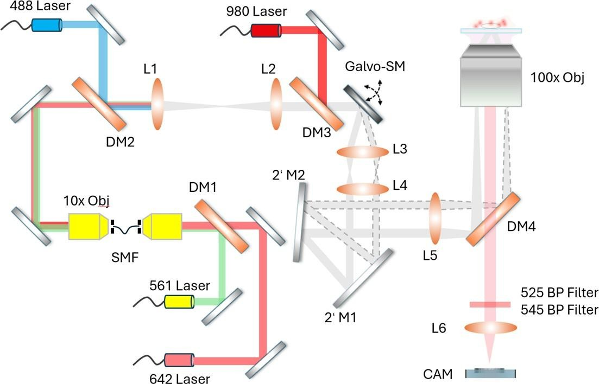

# Spin-TIRF microscope: optical configuration and thermometry acquisition

> **Provenance.** This page documents the custom optical system described in the user-supplied *Spin-TIRF system for subcellular-resolution thermometry.docx*. It records reported configuration details; it does **not** validate temperature estimates or imply that the repository scripts control the microscope.

## Original optical schematic



*Figure from the supplied experimental-methods document; component labels follow that diagram. Confirm redistribution rights before publishing or reusing externally.*

## Documented system configuration

| Module | Configuration stated in the supplied document | Important qualification |
| --- | --- | --- |
| Imaging modality | Custom spinning total internal reflection fluorescence (Spin-TIRF) microscope | Used for near-interface subcellular UCNP thermometry |
| Laser excitation | 488, 561, 642 and 980 nm | Individual power, pulse timing, and sequence not stated |
| Laser spatial conditioning | Single-mode fibre (SMF) and dichroic combination optics | Text reports single-mode-fibre coupling; figure depicts an SMF on part of the beam path, so the exact fibre route for each laser needs confirmation |
| Beam steering | Galvanometric scanning mirror (Galvo-SM) | Rotates excitation around the objective's back focal plane |
| Objective | 100× / NA 1.45 | Immersion type, vendor/model not stated |
| Illumination geometry | Rotation-averaged evanescent TIRF excitation | Penetration depth, incidence angle and scan frequency not specified |
| Optical path components | DM1–DM4; L1–L6; mirrors M1 and M2; 10× coupling optics, as labeled in the schematic | Precise prescriptions and some optical distances not given |
| Thermometry emission | 525 nm and 545 nm bandpass filter channels | Filter bandwidths and acquisition mode (sequential vs simultaneous) not specified |
| Image detector | Scientific CMOS (sCMOS) camera | Brand/model, pixel size, gain and exposure time not specified |
| Readout | 525/545 nm emission intensity ratio of Er³⁺-related UCNP signals | Temperature requires experiment-matched calibration and QC |

## Imaging and analysis principle

1. **Excitation.** The 488-, 561-, 642- and 980-nm laser pathways enter the custom microscope. Dichroic mirrors combine the pathways; the source description reports spatial mode cleaning using single-mode fibres. The drawing does not unambiguously resolve which individual laser paths use which fibre components.
2. **Spinning TIRF.** A galvanometric mirror rotates the focused excitation around the back focal plane of a 100×/1.45 NA objective to provide rotation-averaged illumination close to the glass–cell interface.
3. **UCNP excitation.** The source document describes excitation of near-interface upconversion nanoparticles (UCNPs), with 980-nm excitation relevant to their luminescence; visible lasers also accommodate fluorescence-label excitation.
4. **Detection.** Emission is collected by the same objective and passed via dichroic/relay optics, 525- and 545-nm bandpass filters, and an sCMOS detector.
5. **Ratiometric thermometry.** With background-corrected and spatially compatible channels, measure the emissions and compute the ratiometric feature for a validated pixel/region.

```text
R = I_525 / I_545
L = ln(R)
T = f_calibration(L)
```

This is a **processing expression**, not a calibration equation. ``f_calibration`` must be experimentally measured for the appropriate UCNP material, optical settings and sample condition; its coefficients cannot be inferred from the schematic. The repository README describes **fixed-cell in situ calibration** while this setup document discusses **live-cell imaging**. Any transfer between these conditions warrants explicit validation.

## Acquisition metadata still needed for reproducibility

- Laser output **at sample** (all wavelengths), illumination timing and UCNP excitation settings.
- Galvanometer frequency, TIRF incidence angle, measured near-field penetration depth and illumination homogeneity.
- Objective model/immersion, coverslip thickness, stage temperature and environmental controls.
- Optical hardware identities: SMF/fibre couplers, dichroic cutoffs, emission filter central wavelengths **and bandwidths**.
- Whether 525- and 545-nm images are acquired sequentially or simultaneously; channel drift/registration checks.
- sCMOS model, exposure, readout mode, gain, binning, dark background and saturation settings.
- UCNP formulation, calibration conditions, fit coefficients, measurement uncertainty and any per-organelle adaptations.
- Replication unit, biological controls, phototoxicity checks and blinded ROI definition.

## Interpretation and scope

- TIRF is near-interface imaging: a schematic alone does **not** establish deep 3D organelle temperature measurements.
- Descriptions such as 'uniform' and 'speckle-free' convey the intended illumination design; measured uniformity is not supplied here.
- Pixel-wise temperature maps require validated calibration and QC. The legacy scripts in this repository are historical exploratory analyses and do not constitute a validated acquisition/reproduction package.
- The original setup figure and this experimental-method description are separate from newly added post-publication computational analysis.

## Source

*Spin-TIRF system for subcellular-resolution thermometry.docx*, supplied by the repository author for documenting the instrument. Original diagram extracted without scientific modification and placed at `figures/spin_tirf_optical_layout.jpg`.
