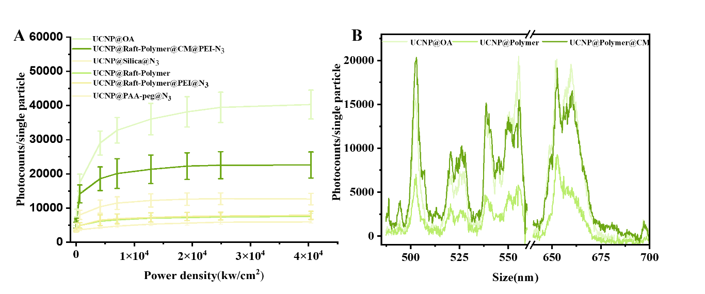
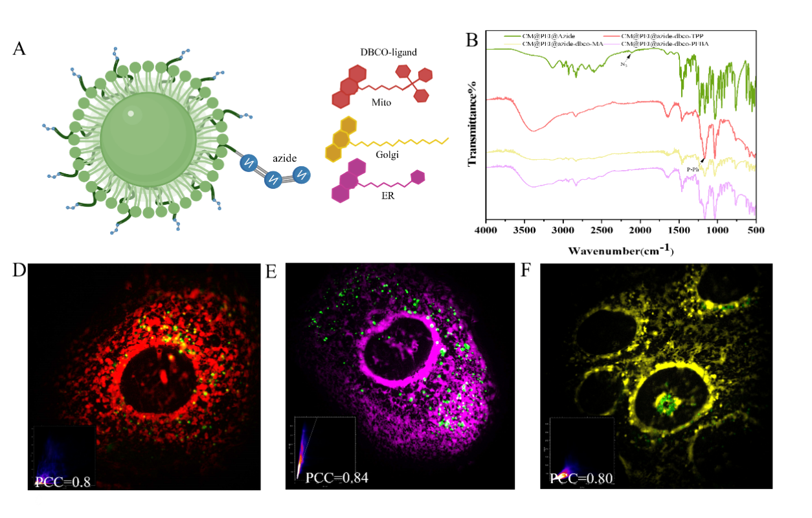
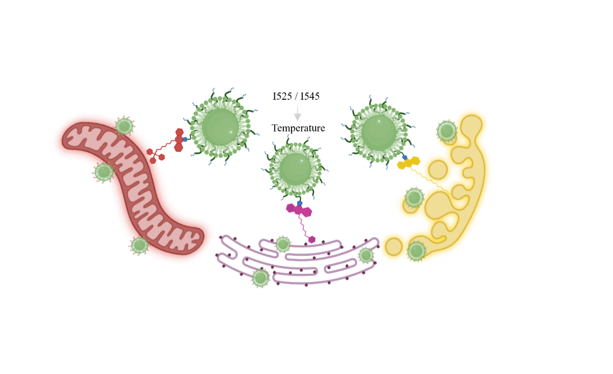
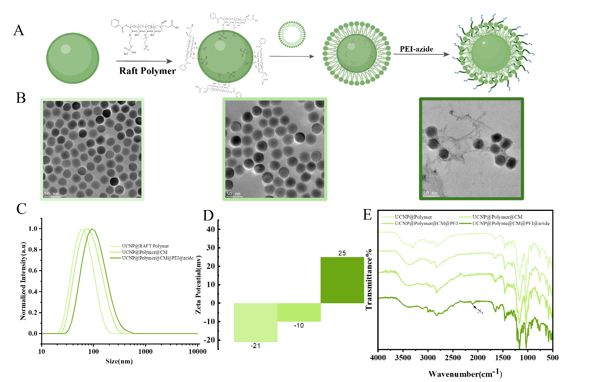
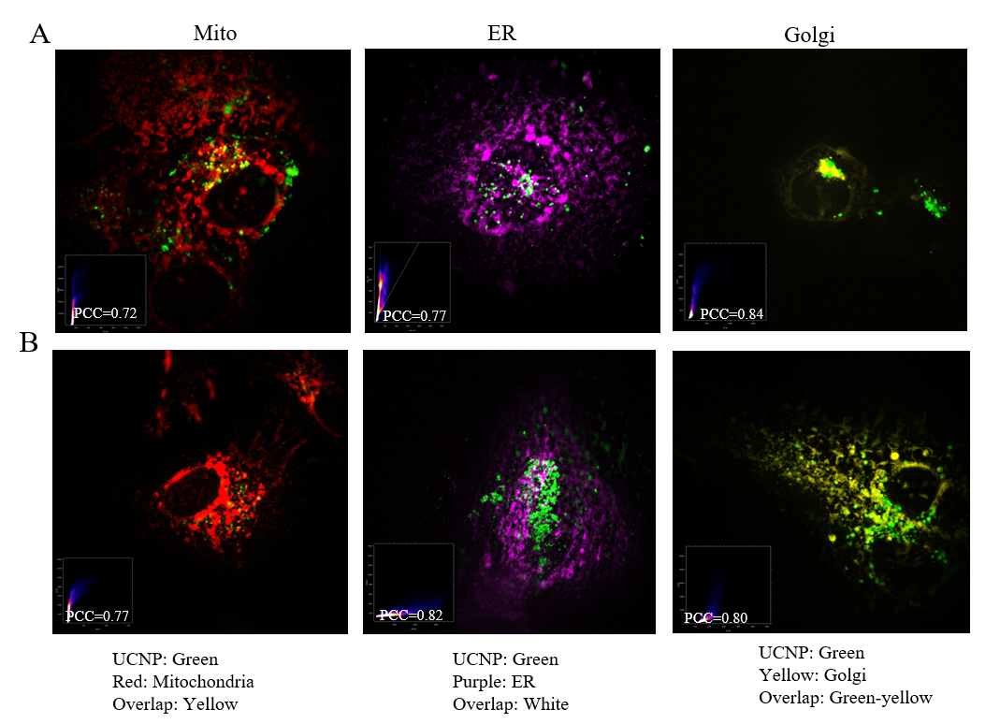
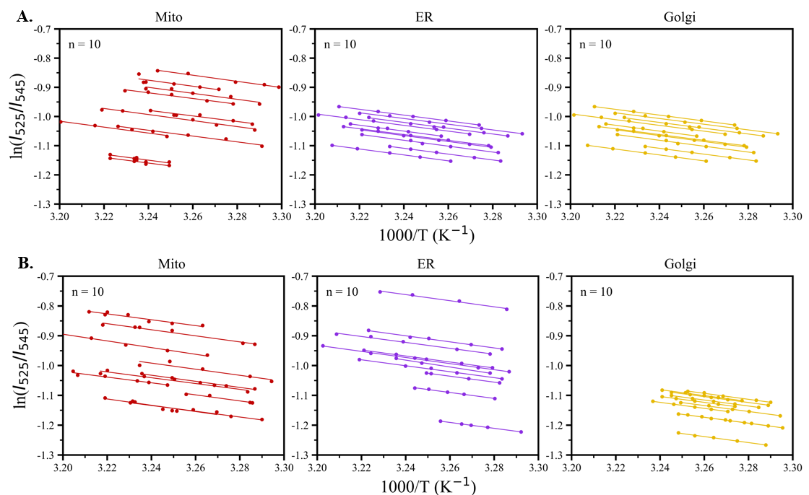

# Manuscript Results Gallery — Organelle-Resolved UCNP Thermometry

> **Provenance:** The figures below were extracted from the author-provided manuscript, *Membrane-camouflaged upconversion nanothermometers uncover organelle-specific thermal signatures of cancer metabolism*. These are **manuscript experimental figures**, not outputs reproduced by the refactored Python pipeline. The publication status of this manuscript has not been established.
>
> **Publication/copyright note:** Confirm co-author, institutional, publisher and submission-policy permissions before putting manuscript figures on a public GitHub repository. Retain any required figure acknowledgments. No raw imaging data are distributed here.

## Key experimental results

### 1. Thermometric spectral integrity and brightness (Figure 2)

Single-particle excitation-dependent emission and the preservation of the Er³⁺ green thermometric bands near 525 and 545 nm following surface modification. As described in the manuscript, membrane-camouflaged particles retain comparatively high photon counts and the relevant emission pair.

### 2. Organelle-selective targeting (Figure 4)

Modular functionalization and representative fluorescence imaging for mitochondria, endoplasmic reticulum (ER), and Golgi apparatus. The original figure is the manuscript's experimental demonstration of targeted localization.

### 3. In situ calibration (Figure 5)

Illustration, 525/545 nm channel images, and **cell-specific organelle-resolved** in situ calibration in BT474 cells. According to the supplied caption, the controlled calibration range is 25–45 °C, with **n = 10 cells per organelle**. Cell-specific calibration lines, rather than the dashed reference trend, were used for subsequent temperature conversion in the manuscript.

### 4. Cell-line and organelle temperature comparisons (Figure 6)

Mitochondria, ER, and Golgi measurements across BT474 (HER2+), MCF-7 (HER2−), and MDA-MB-231 (TNBC) cells. As specified in the manuscript caption, each dot represents a cell; black bars indicate mean ± SEM, and paired comparisons use Holm correction. The metabolic interpretation in panel A is a **hypothesis/interpretation**, not direct evidence of metabolic flux or causation.

## Other main-manuscript figures

### Platform design (Figure 1)

Membrane-camouflaged UCNP thermometry and organelle targeting concept.

### Surface engineering and characterization (Figure 3)

Stepwise surface engineering and physicochemical characterization.

## Selected supplementary figures

### Supplementary Figure 9 — organelle colocalization

Representative TIRF colocalization imaging of organelle-targeted UCNPs in MCF-7 and MDA-MB-231 cells.

### Supplementary Figure 10 — calibration across cells

Additional cell-specific thermometric calibration curves, as labeled in the manuscript.

For the complete manuscript figure wording, see [original captions](ORIGINAL_CAPTIONS.md).

## Relationship to source code

- **Manuscript experimental results:** The figures shown here; they were extracted unchanged in scientific content, with only a white background composited to replace transparency for reliable preview on GitHub.
- **Legacy scripts:** Exploratory analysis scripts retained in the repository root. Their hard-coded paths, calibration choices, and image-selection parameters require review before independent reproduction.
- **Refactored analytical pipeline:** A separate computational reanalysis. Its validity against original experimental raw images, calibration tables, and registration QC has **not** yet been established. Do not label this gallery as results from the refactored pipeline.

**Reproducibility limitation:** No raw microscopy stacks, per-cell calibration tables, registration landmarks, or complete analysis metadata are included in this upload. These figures alone do not independently reproduce the temperature estimates.
